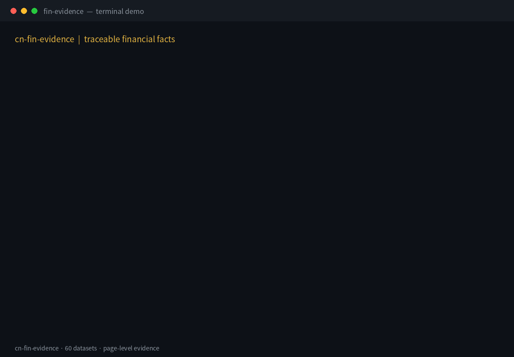

# cn-fin-evidence-mcp

> An A-share financial-statement evidence MCP: **every number returned to an AI can be traced back to an annual-report page; otherwise it is refused.**




This is not another “chat with three financial statements” wrapper. The hard rule is:

> No page number and no verbatim snippet means no number.

## 30-second demo

The source repository ships 60 datasets as JSON (about 12MB); the wheel ships a 2-company / 6-dataset demo bundle, so **PDFs are not required for the demo**:

```bash
python -m venv .venv
. .venv/bin/activate
pip install -e .
fin-evidence --data data demo
```

The demo shows the original 2025 total-assets value of China Shenhua (601088), a later restated comparative, the difference, the review status, and how a wrong claim is rejected.

## What it adds

- **Page-level evidence** for every disclosed fact: company, period, metric, value, unit, page, bbox, verbatim snippet.
- **Three-source comparison**: verified PDF value / Eastmoney structured value / Sina second source.
- **Restatement handling**: original `as_reported` and later `restated_comparative` are kept side by side; reviewed material restatements are tagged `pass_with_restatement`, unreviewed ones still fail.
- **Subject guard**: metric + statement + item alias must agree, or the tool returns `SUBJECT_MISMATCH`.
- **Hard refusal**: unknown evidence, missing page, path traversal, bad tolerance and mismatched claims return structured errors instead of fabricated numbers.

## Scope (v0.2.4 pilot)

- 20 non-financial A-share companies, 2023–2025, 60 datasets.
- 2,016 verified facts, 8,352 statement rows, 34 metric definitions, 9 ratios.
- Audit result: **0 errors / 75 known warnings**; acceptance `true`.
- Tests: **52 / 52 passed**.
- Ten material restatement differences reviewed one by one: **10/10 confirmed true restatements, 0 extraction errors**.

Known warnings: 54 cash-vs-cash-equivalents definition warnings and 21 structured metrics without a verified counterpart. They are disclosed, not silently ignored.

## MCP client configuration

After `pip install -e .`:

```json
{
  "mcpServers": {
    "cn-fin-evidence": {
      "command": "fin-evidence",
      "args": ["--data", "/absolute/path/to/cn-fin-evidence-mcp/data", "serve"]
    }
  }
}
```

VS Code uses `.vscode/mcp.json` with `servers` instead of `mcpServers`.

Docker:

```bash
docker build -t cn-fin-evidence .
docker run -i --rm cn-fin-evidence
```

## Limits

- Not investment advice; values are only authoritative when they match the original annual report.
- Only text-based PDFs are supported. Scanned reports are out of scope.
- No banks, insurers or securities firms yet.
- Cross-chapter consistency, OCR, licensed data adapters and audit-log hash chains are roadmap items.
- PDFs are not committed to git; the full PDF bundle is a Release asset.

## Data and redistribution

See [`DATA_SOURCES.md`](DATA_SOURCES.md). The repository contains derived JSON evidence, not the PDFs. Public annual reports remain subject to their original disclosure terms. Structured values from Eastmoney/Sina are research-only cross-checks, never a substitute for page evidence. Code is MIT; PyMuPDF is AGPL-3.0/commercial dual-licensed, so closed-source commercial distribution needs a separate license or a PDF-parser replacement.

## License

MIT.
