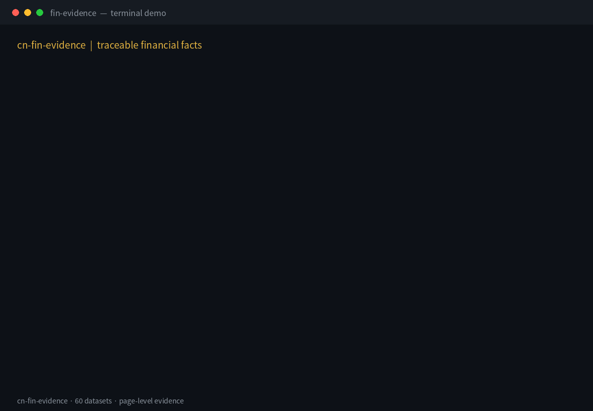

# cn-fin-evidence-mcp

[English](README.en.md) | 简体中文

> A 股财报证据链 MCP：**每个返回给 AI 的数字，都能回到年报页码；回不去的，拒答。**


[](https://github.com/feng01120/cn-fin-evidence-mcp/actions/workflows/ci.yml)




不是“把三表塞进向量库”的财报问答。这个项目只有一条硬规则：

> 找不到页码与原文片段，就不返回这个数字。

## 30 秒跑起来

源码仓库带 60 个数据集的 JSON（约 12MB）；wheel 内另带 2 家公司 / 6 个数据集的精简 demo 数据，安装后可直接离线运行。**两者都不需要先下载 PDF**：

```bash
python -m venv .venv
. .venv/bin/activate        # Windows: .venv\Scripts\activate
pip install -e .
fin-evidence --data data demo
```

输出会展示：中国神华 2025 总资产的原披露值、后发重述值、差额、复核状态，以及错误声称值如何被拒答。

## 为什么值得单独做一个

通用 RAG 能回答“茅台毛利率多少”，但金融从业者真正需要的是：

- 这个数字来自哪一页、哪一行？
- 是年报直接披露的，还是工具算出来的？
- 合并口径还是母公司口径？单位是元还是万元？
- 本期为空，是零、未披露，还是不适用？
- 三表勾稽过没过？哪一项没过？
- 后发披露改了比较数，是正常追溯，还是抽取错误？

`cn-fin-evidence-mcp` 把这些变成结构化字段，而不是提示词里的“请不要编造”。

## 现在能做什么（v0.2.4 试点）

| 能力 | 状态 |
|---|---|
| 从年报 PDF 还原三表科目与数值 | 已实现（文本型 PDF） |
| 每个数值附带公司/期间/指标/数值/单位/页码/原文片段 | 已实现 |
| 单元格坐标 bbox | 已实现 |
| 披露值优先，计算值附公式与输入 | 已实现 |
| 三表勾稽校验（资产=负债+权益、现金流恒等、现金滚存） | 已实现 |
| 同比异常提示（±50% 触发人工复核，不直接判错） | 已实现 |
| 结构化错误、缺证据拒答 | 已实现 |
| 分页与 token 控制 | 已实现 |
| 行级科目可回查 | 科目名/数值无法在本页命中即不写入 |
| structured 覆盖层 | 60 数据集 / 1,200 个东方财富指标；无页码时显式 warning，不冒充 verified |
| 追溯重述隔离 | 差异 >25% 标 `restatement_material`；逐项复核为真实追溯后记 `pass_with_restatement`，未复核仍 fail |
| 第二数据源 | 新浪财经 60 数据集 / 2,040 个指标；先做三源交叉核对，东方财富缺值时作为第二 fallback |
| 科目拦截 | 指标 + 报表归属 + 科目别名三重校验 |
| 示例数据 | 20 家非金融公司 × 2023–2025 年，60 个数据集（2,016 facts / 8,352 rows） |
| 指标覆盖 | 34 个指标定义（31 个必需）、9 个比率 |
| 当前验收 | 随机 20 条证据 20/20 命中；行级审计 0 error / 75 warning；`acceptance=true` |
| 单元/契约测试 | 52 / 52 通过 |

## 当前验收结果（可复跑）

```bash
PYTHONPATH=src python scripts/audit_data.py
PYTHONPATH=src python scripts/accept_20.py
```

当前结果（2026-11-24）：

| 检查 | 结果 |
|---|---|
| 数据集 / 公司 | 60 / 20（2023–2025） |
| `quality_gate`（PDF 原文链路） | pass 60，warning 0，fail 0 |
| `cross_source_gate`（三源比对） | `pass_with_restatement` 5 个数据集（10 个已复核重大追溯指标），其余 55 个 pass；fail 0 |
| 随机 20 条证据回查 | 20 / 20 命中 |
| 四条硬勾稽 | 240 / 240 pass |
| 行级科目/数值页内命中 | 0 error；54 条 `cash_bs_vs_cf` 口径 warning |
| 行级审计 | 8,352 rows，0 条无法回查 |
| structured 覆盖 | 60 / 60 数据集，1,200 指标；1,123 pass / 46 restatement / 10 restatement_material（已复核） / 21 missing |
| 第二源覆盖 | 60 / 60 数据集，2,040 指标；1,960 pass / 45 restatement / 10 restatement_material（已复核） / 25 unverified / 0 missing；`verified_isolated=0` |
| 审计 | 0 error / 75 warning：10 个已复核 material 计入 `reviewed_material_metrics`，不再记 error；75 warning = 54 条现金口径 + 21 条结构化无法交叉核对 |

验收报告：`data/acceptance_report.json`；审计明细：`data/audit_report.json`；逐数据集覆盖：`data/rebuild_report.json`。

10 个 `restatement_material` 的逐项审查结论见 [`docs/MATERIAL_REVIEW.md`](docs/MATERIAL_REVIEW.md)：10/10 确认真实追溯、0 条抽取错误。门禁已按审查结论改为 `pass_with_restatement`；原始 `quality=fail` 保留在结构化源文件中作为审计信号，原始 `as_reported` 与后发 `restated_comparative` 并列保存、不覆盖。

## MCP 客户端配置

先 `pip install -e .`。Claude Desktop / Cursor / 兼容 `mcpServers` 的客户端：

```json
{
  "mcpServers": {
    "cn-fin-evidence": {
      "command": "fin-evidence",
      "args": ["--data", "/absolute/path/to/cn-fin-evidence-mcp/data", "serve"]
    }
  }
}
```

VS Code（`.vscode/mcp.json`）：

```json
{
  "servers": {
    "cn-fin-evidence": {
      "type": "stdio",
      "command": "fin-evidence",
      "args": ["--data", "${workspaceFolder}/data", "serve"]
    }
  }
}
```

Docker：

```bash
docker build -t cn-fin-evidence .
docker run -i --rm cn-fin-evidence
```

## 工具

| 工具 | 作用 | 关键约束 |
|---|---|---|
| `list_companies` | 列出已收录公司与报告期 | 只返回元信息 |
| `get_statement` | 按报表读取科目行 | `statement` 限定三张合并报表；cursor 分页；单页最多 200 行 |
| `get_ratio` | 读取比率 | 每个比率带公式、输入值、`value_type=computed` 和证据对象 |
| `get_evidence` | 按证据编号取六元组 | verified 带页码；structured 明确无页码且 evidence 为空 |
| `verify_fact` | 核对一个声称值 | 相对误差默认 1%；重述值匹配返回 `restatement_match + warning` |
| `get_quality_report` | 勾稽与质量报告 | pass / warning / fail 计数，附 structured 与第二源状态 |
| `get_source_comparison` | verified / 东方财富 / 新浪三源并排 | 返回三源数值、差异与状态；结构化源不替代页码证据 |

返回统一为 `data`、`evidence`、`meta`、`quality` 四个区块；错误返回 `error.code`，不抛异常。

示例（`verify_fact` 命中）：

```json
{
  "data": {
    "verdict": "match",
    "metric": "cash",
    "claimed_value": 51690610946.5,
    "actual_value": 51690610946.5,
    "difference": 0.0,
    "unit": "元"
  },
  "evidence": [{
    "evidence_id": "600519-2025-cash",
    "page": 56,
    "snippet": "货币资金 1 51,690,610,946.50 59,295,822,956.89"
  }],
  "quality": {"status": "pass"}
}
```

## 一个真实案例：当数字与直觉冲突

示例数据里，五粮液 2025 年报披露营业收入 405.29 亿元，上年 891.75 亿元，同比 **-54.55%**；净利润 93.17 亿元，上年 331.93 亿元，同比 **-71.93%**。

这不是解析错误。原文第 56 页就是这么写的。工具不会替用户“修正”成看起来合理的数字，而是：

1. 返回页码、原文片段与单元格坐标；
2. 在 `get_quality_report` 里给出 `growth_anomaly: warning`，提示核对报告口径、追溯重述或业务变化；
3. 勾稽仍然 pass——因为三表内部是自洽的。

这正是证据链 MCP 与“会编数字的聊天机器人”的区别：**数据反常时，先给证据，再给警告，不悄悄替用户下结论。**

## 设计：六层落地情况

| 层 | v0.2.4 做法 | 还没做 |
|---|---|---|
| 数据层 | verified PDF + 东方财富 structured 覆盖层 + 新浪交叉核对；`(code, report_date, announce_date)` 主键；披露值/计算值分开 | 母公司报表、TTM、更多独立源 |
| 溯源层 | 六元组 + 原文片段 + bbox；行级科目也做页内命中；缺证据拒答 | 跨章节正文一致性校验 |
| 工具层 | 七个只读工具，按报表/维度拆分，双 Schema 结构化 | 批量导出 |
| 校验层 | 4 项勾稽 + 0 值三分类 + 同比异常 + 科目三重拦截 + 披露日追溯分级 | 行业口径校验、跨章节比对 |
| 合规层 | 本地审计日志；数据源与授权状态在文档标注 | 防篡改签名、权限模型、持牌源适配 |
| 工程层 | 分页、截断、可组合、52 项契约测试；20 家 × 3 年批量重建；CI / Docker / demo | 托管演示、基准集 |

## 数据与合规

- verified 示例数据来自 20 家上市公司 2023–2025 年公开年度报告，仅用于原型与研究；源 PDF 不入 git，Release 资产单独带 `data/raw`（约 262MB，60 份 PDF + manifest）。
- structured 覆盖层来自东方财富公开三表接口，仅用于原型；没有页码证据，质量固定为 warning，不得冒充 verified，也不得用于商业再分发。
- 第二源来自新浪财经公开三表文本；先用于交叉核对，东方财富也缺值时才作为第二 fallback。两个结构化源都不覆盖 verified，也不提供页码。
- `restatement` 表示 API 披露日晚于数据集公告日，可能是后发年报追溯/重分类；`restatement_material` 表示差异超过 25%，仍需人工核对合并范围与会计政策变更。
- `scripts/fetch_report.py` 走巨潮资讯官方公告接口；**不得**把该接口用于商业再分发。
- 生产环境应替换为持牌数据源（Wind、Choice、通联等）的适配层。
- 本项目不构成投资建议；所有数值以原始年报为准。
- 代码 MIT，但 PDF 解析依赖 PyMuPDF 为 AGPL-3.0/商业双许可；闭源商业分发前必须处理，见 [`THIRD_PARTY_LICENSES.md`](THIRD_PARTY_LICENSES.md)。

## 测试

```bash
PYTHONPATH=src python -m unittest discover -s tests -v
```

覆盖：六元组完整性、证据编号唯一、比率数值与证据对象、4 项勾稽、分页、命中/不匹配、未知证据/指标/游标/限流/容差拒答、缺少期初值的降级、复核重述门禁。

自检报告与已知边界见 [`docs/AUDIT.md`](docs/AUDIT.md)。数据审计（需要原始 PDF）：

```bash
python scripts/audit_data.py
```

逐条检查：证据片段能否在对应 PDF 页原文中命中、页码是否越界、bbox 是否有效、源文件 SHA-256 是否一致、比率输入证据是否存在。任何一项失败返回非零退出码。

## 目录

```
src/fin_evidence/
  models.py      # 证据、比率、校验结果的数据契约
  mapping.py     # 科目别名与报表分段
  extract.py     # PDF 行还原、跨行科目合并、页码/bbox/片段
  structured.py  # 东方财富结构化覆盖层与追溯分级
  sina.py        # 新浪第二源与三源比对
  subject.py     # 指标/报表/科目三重拦截
  ratios.py      # 比率公式与勾稽
  store.py       # 数据集与审计日志
  server.py      # MCP 工具
  cli.py         # build / inspect / demo / serve
  demo.py        # 30 秒演示
data/            # 已构建的示例数据集（JSON，随仓库）
data/raw/        # 60 份 PDF（约 262MB，不进 git，见 Release）
scripts/         # 年报下载、数据审计、demo 渲染
tests/           # 契约测试
docs/            # 审计、规格、逐项重述审查
```

## 路线图

- **v0.2（已完成）**：20 家公司 × 3 年、60 个数据集、行级证据回查、批量重建、验收报告。
- **v0.2.2（已完成）**：structured 追溯分级、新浪第二源三源比对、抽取锚点/列/单位修复。
- **v0.2.3（已完成）**：新浪扩展到 34 指标并成为第二 fallback；10 个重大追溯指标升级为 fail；raw PDF 随包。
- **v0.2.4（已完成）**：10 条重大追溯逐项复核；已复核 material 改记 `pass_with_restatement`，未复核仍 fail；原始两套口径并列保存；GitHub 发布形态、CI、Docker、30 秒 demo。
- **v0.3**：跨章节一致性、扫描件 OCR、第二源进入覆盖层前的准入规则、审计日志哈希链。
- **v1.0**：持牌数据源适配、多期对比、行业模板、可复现的评估报告。

## 发布

- [v0.2.4 Release Notes](docs/RELEASE_NOTES.md)
- [GitHub 发布清单](docs/GITHUB_RELEASE_CHECKLIST.md)
- [Launch Kit](docs/LAUNCH_KIT.md)

## License

MIT。数据来源与再分发限制见 [`DATA_SOURCES.md`](DATA_SOURCES.md)；依赖许可证见 [`THIRD_PARTY_LICENSES.md`](THIRD_PARTY_LICENSES.md)。
